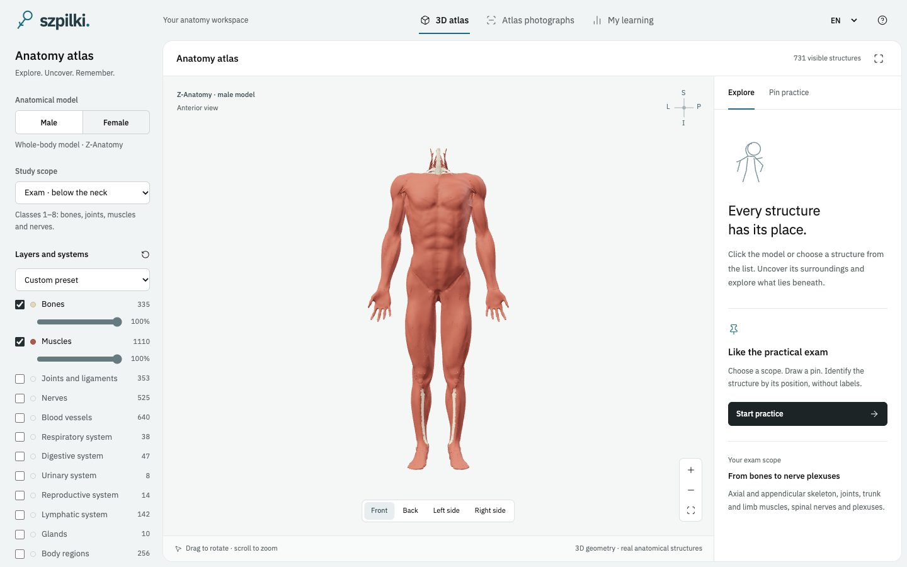
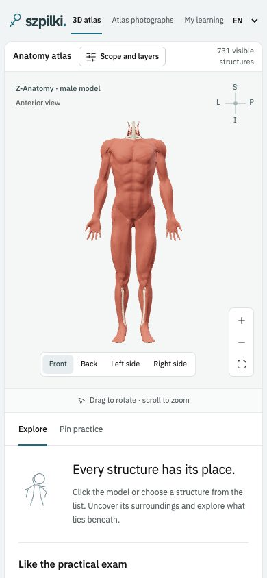

# Szpilki

**Anatomy practical exam practice: identify the structure, then understand where it belongs.**

[Open the app](https://deenuu1.github.io/szpilki/) · [How it works](#atlas-photographs) · [Run locally](#development) · [Data and licences](#data-and-licences)



_Actual application screenshot. Anatomy geometry: Z-Anatomy / BodyParts3D (DBCLS), CC BY-SA 4.0. Adapted GLB assets and metadata: Anatria3D. See [full credits](public/anatomy/NOTICE)._

Szpilki is a browser-based study tool for anatomy “pins” exams. Explore real anatomical meshes in 3D, or practise on photographs from your own atlas: draw a pin, type its name, and reveal an explanation of the landmarks, attachments or nerve relationships that help identify it.

Polish is the default. Switch to English at any time; your explicit choice is remembered on the device.

## Atlas photographs

1. Open **Atlas photographs**. Open the linked atlases in Drive, read Yokochi in the built-in preview, or add your own PDF for pin practice.
2. Choose **Whole McMinn · printed numbers** and a PDF page range, or **Prepared pins · explanations + 3D** and syllabus filters.
3. Draw a photograph and type the name of the requested printed number or pinned structure.
4. In whole-book mode, reveal the original caption and self-grade. Prepared pins check the name and reveal bilingual recognition and relationship notes.
5. Prepared pins also offer **Show in 3D** for the corresponding bone or nerve.

**Whole McMinn · printed numbers** adds **6,784 numbered-caption questions on 317 PDF pages**. Select a page range, identify a printed number, type an answer and reveal the original source caption. The page commentary becomes visible too, with a full-size reading view. Grade yourself against your own PDF. All 362 pages can be opened for reading.

This mode uses automatically located captions, which have not all been individually reviewed. It does not automatically grade OCR text or invent medical explanations. Exclude unsuitable questions locally and restore them later. Source captions remain in Polish/Latin even with English UI. See [coverage, limitations and the offline extraction workflow](docs/mcminn-index.md).

The included McMinn deck contains **174 manually positioned pins for 153 distinct anatomical names**, on 21 PDF pages: 36 bony landmarks, 80 muscle/tendon/fascial questions, 39 nerve questions and 19 joint/ligament questions. The expanded questions cover axillary and posterior shoulder dissections, the elbow and proximal forearm, the gluteal region, anterior thigh, popliteal fossa, anterior leg, knee ligaments, the palm/dorsal hand and wrist, and medial/lateral ankle and foot dissections. Each has original bilingual recognition and relationship notes, a source figure/label reference and a validated 3D link. Selected material from classes 2–8 is covered; the axial skeleton and the rest of the syllabus are not yet fully authored. [Coverage and content checks](docs/curated-pins.md).

The deck is matched to an exact scan by SHA-256. Other editions, including a different McMinn scan, do not silently reuse its coordinates. You can add your own labelled points and bilingual explanations to other PDFs, including Yokochi. Those annotations join your practice pool and JSON export. Original textbook pages are **not distributed in this repository**.

For bony landmarks, the 3D link opens the corresponding bone; it does not claim that the landmark has its own labelled mesh. Recognition notes are original, source-referenced study summaries. They are not generated dynamically by an LLM.

## 3D atlas

- Rotate, pan and zoom real anatomical models; choose anterior, posterior or lateral views.
- Filter by region, including the below-the-neck exam scope.
- Show, hide and change the opacity of anatomical systems.
- Search source English and Latin nomenclature and the available Polish translations.
- Focus, isolate or hide an individual structure.
- Practise random surface pins, optional 30-second questions and mistake-focused review.
- Type an answer or reveal it and self-assess. Unrecognised synonyms can be accepted manually.

The male atlas contains **3,478 dataset elements**, including 335 skeletal, 1,110 muscular, 353 articular and 525 nervous-system entries. These are mesh elements, not a count of distinct named human organs: some are paired, partial or attachment components. Separate muscle-attachment meshes are excluded from the ordinary muscle view and quiz pool.

The incomplete female HRA viewer has been withdrawn from the interface. Earlier female-session records remain in study exports; an unfinished female 3D session is closed when restoring older data, and the viewer uses the male whole-body atlas. Legacy HRA assets and their attribution remain in the repository. Not every bony groove, tubercle or foramen is separately identified in the 3D data, and Polish 3D labels are currently a curated subset; source English and Latin names remain available.



_Mobile view of the same application. Anatomy: Z-Anatomy / BodyParts3D (DBCLS), CC BY-SA 4.0; Anatria3D conversion. No textbook scans are included in these repository screenshots._

## Progress and sessions

**My learning** keeps answer history, mistakes and sessions on the device. An unfinished question, its typed draft, revealed state and timer deadline survive a refresh. Completed sessions remain in history. Export and import JSON to move learning records and custom photo annotations between browsers.

| Data                                             | Storage                                |
| ------------------------------------------------ | -------------------------------------- |
| Language selection                               | `localStorage`: `szpilki-language`     |
| Answers, sessions, atlas settings, custom points | `localStorage`: `szpilki-study-v3`     |
| Last selected PDF                                | `localStorage`: `szpilki-atlas-choice` |
| PDF files                                        | IndexedDB: `szpilki-atlas-files`       |

PDFs are too large for `localStorage`; their bytes stay in IndexedDB. Nothing is uploaded. JSON exports contain learning data and references, not the PDF files. Browser data is scoped to the origin: localhost and the public GitHub Pages site have separate records. Clearing browser data removes the local copy.

## Ratings and spaced reviews

After checking or revealing an answer, choose **1 · Again**, **2 · Hard**, **3 · Good**, or **4 · Easy**. Checking a name does not record a failed review. A one-character typo can produce a suggestion, but the learner chooses the grade; related anatomical names and numeric levels are never automatically accepted as typos.

Scheduling uses pinned [`ts-fsrs` 5.4.2](https://github.com/open-spaced-repetition/ts-fsrs), an implementation of the [FSRS algorithm supported by Anki](https://faqs.ankiweb.net/what-spaced-repetition-algorithm.html). Retention is 90%, with initial learning steps of 10 minutes and 1 hour and a 10-minute relearning step. All four buttons preview the actual due interval; Hard and Easy are adaptive rather than fixed to 30 minutes and one day. This app does not sync with Anki or train personalised FSRS weights.

Within the selected scope, due cards come before new cards; cards scheduled for the future are held back. **Practise before due date** explicitly allows early review. Drawing or revealing a card does not change its schedule. **My learning** lists due dates. Review state, ratings, optional recognition reasoning and unfinished drafts are stored locally and included in JSON exports. Version 3 storage migrates earlier exports and uses a separate key, retaining the original v2 browser data.

The optional reasoning field is a learner's note for comparing recognition with the available explanation. It is not automatically assessed by a medical model. A new card clears both fields; refreshing the same card restores its drafts.

Whole-book questions now have automatically inferred bones, joints/ligaments, muscles, nerves and other/unclassified filters. These are source-caption heuristics, not expert-reviewed classifications. The authored deck contains 174 prepared pins; the larger mode still uses page-based numbered questions and original source captions, without newly authored anatomical explanations for every item.

## Automatic photo practice

The **Automatic pins · 9,928 proposals** mode makes the full batch available in the web app. Add the matching McMinn PDF once, choose a page range, anatomical category or detection filter, type an answer, reveal the original caption and rate recall 1–4. Ratings, exclusions and resumable sessions stay on the device. The 119 individually prepared questions remain in their own mode.

Automatic rectangles locate printed numbers, not verified anatomical pin tips. Some detections are diagrams, text or conflicting OCR; multiple possible captions remain visible and missing captions are explicit. Use the detection filter or exclude unsuitable questions. Only existing authored notes are reused where a single source caption has an exact name match; most proposals do not yet have a reviewed explanation. The repository contains geometry and note references, without atlas scans or OCR prose. See [automatic practice](docs/automatic-practice.md).

## Offline preparation of further specimen questions

The [batch proposal and review workflow](docs/atlas-automation.md) processes the local scan into numbered-marker proposals, a provisional Latin glossary and a local review page. It reuses exact name/model matches and reviewed teaching notes while requiring confirmation of actual tissue tips, crops and bilingual content before export. The reviewed export remains separate from the clearly labelled automatic-proposal mode. Atlas pixels and raw OCR outputs stay in ignored local files.

## Development

Requires Node.js 22.12 or newer in the Node 22 series, or a supported newer version.

```bash
npm ci
npm run dev
```

Open the local URL printed by Vite. Production build and preview:

```bash
npm run build
npm run preview
```

Checks:

```bash
npm test
npm run assets:verify
npm run build
```

The test suite covers whole-book geometry, page-range selection, source identity, backward-compatible book-session persistence, session persistence and migration, answer handling, review selection, import merging, language preferences, model-node consistency and every starter photo point's bounds and 3D link. The asset verifier checks SHA-256 hashes for all vendored anatomy files.

The app uses TypeScript, Three.js, PDF.js, Zod and Vite. It needs no backend, login, AI provider key or paid service. The build is a static `dist/` directory with relative asset paths, suitable for a GitHub Pages project site.

## Deployment

[GitHub Actions](.github/workflows/ci.yml) runs asset verification, tests and the type-checked production build on pull requests. A successful `main` build deploys to GitHub Pages. Repository Pages settings must use **GitHub Actions** as the source.

`main` is intended to require a pull request and the `Verify` status check, with force pushes and deletion disabled. See [contributing](CONTRIBUTING.md) for the development workflow.

## Data and licences

Application code: [MIT](LICENSE). Anatomical assets keep their own licences:

| Dataset                                           | Coverage                                         | Licence                                                      |
| ------------------------------------------------- | ------------------------------------------------ | ------------------------------------------------------------ |
| Z-Anatomy, derived from BodyParts3D / DBCLS       | Male atlas                                       | CC BY-SA 4.0; upstream BodyParts3D attribution also retained |
| Human Reference Atlas / NIH, Visible Human Female | Female torso and pelvis                          | CC BY 4.0                                                    |
| Anatria3D conversions                             | GLB compression, identifiers and source metadata | Respective upstream licences                                 |

See [asset licences](public/anatomy/LICENSE), [complete attribution and modifications](public/anatomy/NOTICE), and [pinned source URLs and checksums](public/anatomy/provenance.json). Model screenshots are derivatives of their credited datasets. Typeface: IBM Plex, SIL Open Font License. Icons: Lucide, ISC licence. Draco decoder: Google Draco, Apache 2.0; see [decoder credits](public/draco/README.md).

Assets are vendored so the running application does not depend on another anatomy viewer's availability. To reproduce the pinned download:

```bash
npm run assets:fetch
npm run assets:verify
```

This is a study aid, not an exhaustive or professionally validated medical reference. Confirm the terminology and specimen interpretation expected by your anatomy instructor.

## Linked atlas reading

The atlas library links to the two user-supplied Google Drive PDFs. Yokochi opens in an in-app Drive preview on request, with an external-link fallback. Drive reports that the 110 MB McMinn file is too large to preview, so its card offers a Drive download/open link and local PDF import instead. Google controls preview availability and download access. PDF pin practice still uses a one-time local file import; the Drive preview is a reading surface, not the PDF.js quiz canvas. No Drive credentials or API keys are embedded in the site, and file-sharing permissions are unchanged.
